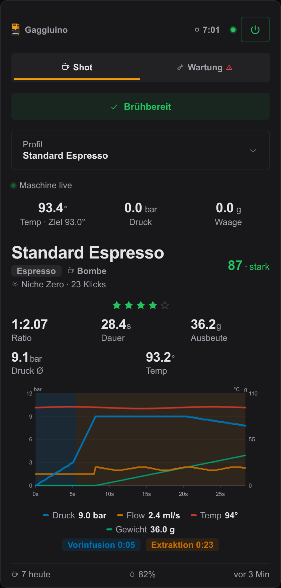
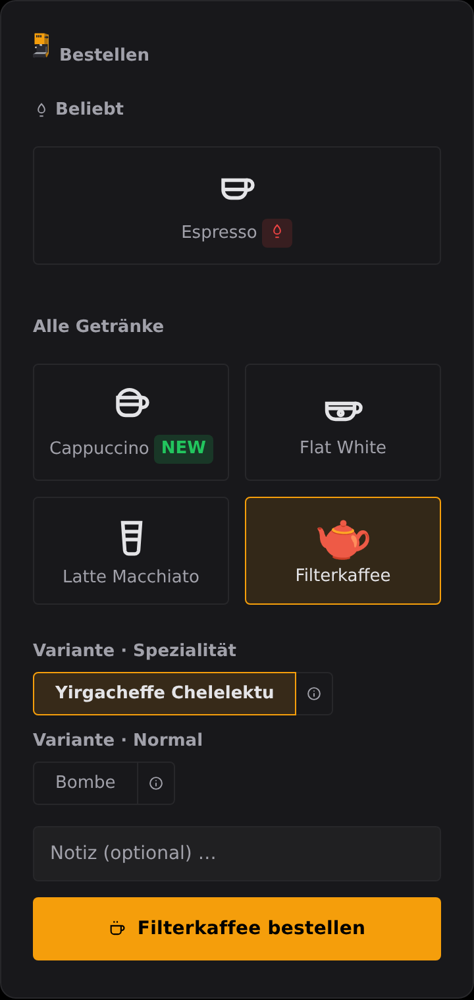

# Gaggiuino Local Profiler — Home Assistant Integration

Integrates the [Gaggiuino Local Profiler](https://github.com/mxkissnr/gaggiuino-local-profiler) as native HA entities — machine status, shot data and live brew status directly in Home Assistant, no cloud.

## Requirements

- [Gaggiuino Local Profiler App](https://github.com/mxkissnr/gaggiuino-local-profiler) installed and running
- Home Assistant 2024.7.0 or newer

## Installation

### HACS (recommended)

1. Search HACS for *Gaggiuino Local Profiler* and install
2. Restart Home Assistant

### Manual

1. Copy the `custom_components/gaggiuino_profiler/` folder into `config/custom_components/`
2. Restart Home Assistant

### Beta versions

To test upcoming changes, open this integration in HACS, open the three-dot menu and choose *Redownload*, then expand *Need a different version?* and pick the beta release from the *Release* list (tags like `v1.33.2b1`). Choose *Download* and restart Home Assistant. You then get the development build of the integration and both cards. It is for testing only and may be broken. To go back, open the same dialog and pick the newest stable release.

## Setup

1. **Settings → Devices & Services → Add Integration**
2. Search for *Gaggiuino Local Profiler*
3. On Supervisor installs, setup first tries to auto-discover the add-on — including over the internal container network, so a host-port mapping is no longer required for this to work. If auto-discovery succeeds, the integration is added automatically with no further input.
4. If auto-discovery doesn't find it, enter the GLP app's URL manually: `http://localhost:8099`
   > **Use `localhost`, not `homeassistant.local`** — mDNS resolution fails intermittently inside HA OS and makes all sensors unavailable. `localhost:8099` always works reliably.

The integration tests the connection right away during setup.

## Shot Card

The GLP Shot Card ships inside this integration and is registered automatically as a dashboard resource on setup — no separate HACS install or manual resource config needed. Add a card with `type: custom:glp-card` to your dashboard after installing this integration. The source lives in [`cards/shot/`](cards/shot/).



Minimal configuration — the entity prefix is detected from the `*_machine_status` entity the integration creates:

```yaml
type: custom:glp-card
```

Full configuration:

```yaml
type: custom:glp-card
title: Gaggiuino
entity_prefix: sensor.gaggiuino_local_profiler_
switch_entity: switch.espresso_plug
glp_url: http://homeassistant.local:8099
machine: Kitchen GaggiMate
theme: ember-espresso
```

### Shot Card options

| Option | Description | Default |
|---|---|---|
| `title` | Card header title | `Gaggiuino` |
| `entity_prefix` | Prefix shared by this integration's entities. Takes precedence over `machine` when both are set. | *(auto — from the `*_machine_status` entity)* |
| `switch_entity` | Switch entity of the machine's smart plug. The header power button toggles it, and the card shows an "off" view while it reports `off` or `unavailable`. | *(auto — from the `machine_status` sensor's `switch_entity` attribute)* |
| `glp_url` | URL of the GLP app's web interface. Adds a "GLP ↗" link to the footer. | *(none)* |
| `machine` | Name or id of one machine from the app's multi-machine registry. Matches the `*_machine_status` entity whose name or entity id references it, and scopes the remembered switch entity per machine so two cards don't overwrite each other. | *(auto — first Gaggiuino-named machine, else the first one found)* |
| `theme` | One of the eight colour presets below. Colours the card's accent tokens and the machine icon. | *(none — Home Assistant's `--primary-color`)* |
| `accent_color` | Custom flat accent colour as `#rrggbb`, instead of a preset. Overrides `theme`. Values that aren't a six-digit hex colour are ignored. | *(none)* |
| `accent_gradient` | Custom two-stop gradient as `["#rrggbb", "#rrggbb"]`. Overrides `theme` and `accent_color`. Values that aren't six-digit hex colours are ignored. | *(none)* |

### Machine colour theme

The card's accent colour can be themed per machine, so machines are easy to tell apart on a dashboard that shows more than one:

```yaml
type: custom:glp-card
theme: twilight-turkish
```

```yaml
type: custom:glp-card
accent_gradient: ["#dc4a1f", "#f5a623"]
```

The eight preset keys: `amber-americano`, `ruby-ristretto`, `copper-cortado`, `twilight-turkish`, `marbled-macchiato`, `ember-espresso`, `mulberry-mocha`, `frosty-flat-white`.

A theme set in the app (Settings → Machines) is read live from the `machines` attribute of the `*_machine_status` sensor and applied without any YAML — it also picks the machine icon for Gaggiuino and GaggiMate. That synced theme takes precedence over the YAML options above; the options are the manual override and the fallback for setups with no app-side theme. Among the YAML options, `accent_gradient` wins over `accent_color`, which wins over `theme`.

### What the Shot Card shows

- Machine status dot (online / error / brewing) and the time since the last sync
- Preheat progress bar with a countdown and a "Ready to brew" badge once warm; on a GaggiMate, standby is shown as off
- "Ready by" preheat scheduler while the machine is off — a native time picker with Set and Cancel, a live countdown of when the machine switches on, and the scheduled target time; a time already passed today is scheduled for tomorrow. It calls the `gaggiuino_profiler.set_ready_by` service
- Shot navigation — arrows and up to ten dot indicators for the recent shots in the `machine_status` sensor's `recent_shots` attribute, plus swipe left/right on touch devices; resets to the newest shot when a new one arrives
- Shot chart — pressure and flow on the left axis, boiler temperature and weight on the right axis, with a legend of the peak and final values, for the displayed shot and for the running shot
- Live machine tiles while the machine is on — boiler temperature with its target (highlighted while heating), live pressure and live scale weight; during a shot the same values as mini-stats
- Profile picker for `select.*_profile` — stays open across state updates and is hidden when the entity is missing
- Orders tab when the app has open barista orders, with a count badge and accept/decline/complete actions
- Maintenance tab when the maintenance sensors exist — the five maintenance tasks plus a row per grinder, each with a status pill, days/shots since the last service and a progress bar; tap a task to mark it done through `gaggiuino_profiler.maintenance_done`
- Steam banner while the steam switch is on, descaling banner while the machine runs its descale program
- Water level in the footer with a warning banner below 20 %
- Last shot: profile, drink type, coffee with the bean's variety and roast age from the coffee library, grinder and grind setting, star rating, score verdict, brew ratio, duration, yield, average pressure and brew temperature
- Shots pulled today

### Shot Card languages

The card follows the language of the logged-in Home Assistant user, falling back to a sensible default until Home Assistant is available. Supported: 🇩🇪 DE, 🇬🇧 EN, 🇮🇹 IT, 🇫🇷 FR, 🇪🇸 ES, 🇳🇱 NL. Any other language falls back to English.

## Order Card

The GLP Order Card ships inside this integration the same way and is registered automatically as a dashboard resource on setup. Add a card with `type: custom:glp-order-card` to your dashboard after installing this integration. The source lives in [`cards/order/`](cards/order/).



Minimal configuration — no options are needed in a standard Home Assistant setup:

```yaml
type: custom:glp-order-card
```

Without `glp_url` the card goes through the integration proxy, which Home Assistant authenticates with your own session — no token is stored anywhere. That is the recommended setup. Only set `glp_url` (and then `glp_token`) when the card has to reach the app directly, for example on a dashboard outside Home Assistant.

Full configuration (only needed for direct access outside Home Assistant):

```yaml
type: custom:glp-order-card
title: Order
glp_url: http://homeassistant.local:8099
switch_entity: switch.espresso_plug
machine: Kitchen GaggiMate
theme: ember-espresso
```

### Order Card options

| Option | Description | Default |
|---|---|---|
| `title` | Card header title | *(localised — `Order`, `Bestellen`, …)* |
| `glp_url` | URL of the GLP app on port 8099. Only needed when the card is used outside Home Assistant or ingress auto-detection doesn't apply. | *(auto — HA ingress)* |
| `glp_token` | API token of the GLP app, only for direct-URL mode. Warning: every Home Assistant user who can open the dashboard can read it in the YAML. | *(none)* |
| `switch_entity` | Switch entity of the machine. The card shows an "off" view while it reports `off` or `unavailable`. | *(auto — from the `machine_status` sensor's `switch_entity` attribute)* |
| `machine` | Name or id of one machine from the app's multi-machine registry. Selects which machine's `*_machine_status` entity provides `switch_entity`, tags each placed order with the machine name, and scopes the machine theme. | *(auto — first Gaggiuino-named machine, else the first one found)* |
| `new_badge_days` | How many days a newly added menu item keeps its NEW badge. | `7` |
| `theme` | One of the eight colour presets below. Colours the order button, the selection highlights and the machine icon. | *(none — Home Assistant's `--primary-color`)* |
| `accent_color` | Custom flat accent colour as `#rrggbb`, instead of a preset. Overrides `theme`. Values that aren't a six-digit hex colour are ignored. | *(none)* |
| `accent_gradient` | Custom two-stop gradient as `["#rrggbb", "#rrggbb"]`. Overrides `theme` and `accent_color`. Values that aren't six-digit hex colours are ignored. | *(none)* |

Every option above can also be set in Home Assistant's visual card editor, which shows the same labels and a short help text under each field. The two direct-URL options sit in an "Advanced / direct URL" section.

### Machine colour theme

The Order Card uses the same eight presets and the same precedence as the Shot Card:

```yaml
type: custom:glp-order-card
theme: twilight-turkish
```

```yaml
type: custom:glp-order-card
accent_color: "#7f1d1d"
```

The preset keys: `amber-americano`, `ruby-ristretto`, `copper-cortado`, `twilight-turkish`, `marbled-macchiato`, `ember-espresso`, `mulberry-mocha`, `frosty-flat-white`.

A theme set in the app (Settings → Machines) is read live from the `machines` attribute of the `*_machine_status` sensor and wins over the YAML options; the options are the manual override and the fallback when the app has no theme for the machine. Among the YAML options, `accent_gradient` wins over `accent_color`, which wins over `theme`.

### What the Order Card shows

- Drink menu configured in the app's **Orders** tab — a "Trending" section for marked drinks, a NEW badge on items added within `new_badge_days`, and the rest under "All drinks"
- Bean variants from the coffee library for drinks that use beans — only beans still in stock, grouped into Speciality and Normal; a bean with taste notes, origin (multi-origin blends as parsed countries), variety or processing gets a small info button that opens its details in a bottom sheet
- An optional note field, and an order button labelled with the selected drink and variant
- A short Home Assistant notification and a vibration on phones when the order was sent or failed — both use Home Assistant's documented card events, so they appear wherever Home Assistant shows its own messages
- Order status: waiting for confirmation with the queue position and estimated time, accepted with a live ETA countdown, ready with a confirmation plus the finished shot and its curve when the order carries a shot id, declined with the reason
- A "machine is off" or "orders paused" view instead of the menu when the barista or the machine says so

### How it works

1. The card loads the menu, the order settings and the queue estimate from the app (`api/orders/menu`, `api/orders/settings`, `api/orders/queue-eta`), through the integration's REST proxy when it runs inside Home Assistant
2. For drinks that use the coffee library, the bean variants come from `api/orders/active-beans` — only beans actually in stock are offered
3. The customer picks a drink, optionally a variant and a note, and presses the order button
4. The order is submitted with the logged-in Home Assistant user's name as the customer
5. The card polls its own order's status — every 3 seconds while an order is waiting or accepted, every 10 seconds otherwise — and updates itself
6. When the barista accepts the order, the card shows the ETA countdown; when it's done, the confirmation and the shot summary
7. The customer can then place a new order

The barista accepts and completes orders in the app's **Orders** tab.

### Order Card languages

Detected from the language of the logged-in Home Assistant user, with the browser locale as the fallback before Home Assistant is available. Only the first two letters of the code are read, so regional variants such as `de-CH` and `en-GB` work. Supported: 🇩🇪 DE, 🇬🇧 EN, 🇮🇹 IT, 🇫🇷 FR, 🇪🇸 ES, 🇳🇱 NL. Any other language falls back to English.

## Options after setup

**Settings → Devices & Services → Gaggiuino Local Profiler → Configure**

| Option | Default | Description |
|---|---|---|
| URL | *(URL entered above)* | URL of the GLP app |
| Poll interval | `60` | Update interval in seconds (10–300) |

## Entities

All sensors/entities update at the poll interval of their respective coordinator: the main coordinator (`coordinator.py`) every 60 seconds (configurable, see above), and the machine coordinator (`machine_coordinator.py`) every 5 seconds for live machine values. The live coordinator (`live_coordinator.py`, driving the `Brewing` sensor) is pushed live over the add-on's SSE stream (near-instant) since v1.30.0, falling back to a 2-second poll only while that stream is unavailable.

### Relationship to Gaggiuino firmware's own MQTT entities

Newer Gaggiuino firmware (build 7889b7d+) can publish its own MQTT/Home Assistant auto-discovery entities directly — boiler temperature/pressure/flow/weight, brew/steam/hot-water status, an operation-mode select, active profile, a tare button, and live shot-in-progress sensors. This integration never talks to the machine directly — it only polls the add-on's own REST API — so nothing here is affected by enabling firmware MQTT.

If you enable both, some entities will look duplicated (this integration's `Machine Live Pressure`/`Machine Live Weight`/`Machine Water Level`/`Machine Temperature`/`Machine Active Profile`/`Operation Mode`/`Tare Scale` overlap with the firmware's native equivalents) — that's expected, not a bug, and either set can be safely ignored/disabled per your preference. This integration additionally provides things firmware-native MQTT does not: persisted shot history and scoring, preheat scheduling, broader (5-task) maintenance tracking with configurable thresholds, and (since v1.26.0) boiler/display/scales/LED settings control (number/switch/light) and a release-channel select.

### Sensors

| Entity | Description | Unit |
|---|---|---|
| Machine Status | `online` / `error` | — |
| Shot Count | Total number of shots stored | shots |
| Shots Today | Number of shots pulled today | shots |
| Last Shot Profile | Name of the extraction profile | — |
| Last Shot Rating | Manual star rating of the last shot (annotation, not an automatic score) | ★ |
| Last Shot Date | Timestamp of the last shot | — |
| Last Shot Duration | Brew duration | s |
| Last Shot Avg Pressure | Average extraction pressure | bar |
| Last Shot Yield | Yield (output weight) | g |
| Last Shot Brew Ratio | Yield ÷ Dose | — |
| Last Shot Dose | Dose (input weight) | g |
| Last Shot Coffee | Coffee annotation | — |
| Last Shot Grinder | Grinder annotation | — |
| Last Sync | Timestamp of the last sync | — |
| Machine Hostname | Hostname of the Gaggiuino controller | — |
| Machine Temperature¹ | Current boiler temperature | °C |
| Machine Target Temperature¹ | Target boiler temperature | °C |
| Preheat Elapsed | Elapsed preheat time (`unknown` while the machine is in standby) | s |
| Preheat Remaining | Time remaining until preheat is ready (`unknown` while the machine is in standby) | s |
| Preheat Ready By | Scheduled target time for preheat readiness (`set_ready_by` service) | — |
| Preheat Planned Switch On | Scheduled switch-on time to hit the ready-by target | — |
| Maintenance Descaling / Backflush / Group Head / Gaskets / Water Filter | Status (`status` attribute) of each maintenance task, plus `days_since`, `shots_since`, `last_date`, `pct` attributes | — |
| Maintenance Grinders | Maintenance status per configured grinder (`grinder_maintenance_details` attribute) | — |
| Machine Live Pressure | Live pressure straight from the machine (machine coordinator) | bar |
| Machine Water Level | Live water level | % |
| Machine Live Weight | Live weight on the scale | g |
| Machine Uptime | Controller uptime since its last restart | s |
| Machine Active Profile | Profile currently active on the machine | — |
| Pump Flow | Live pump flow rate | L/min |
| Weight Flow | Live flow rate on the scale | g/s |
| Water Temperature | Live water (boiler inlet) temperature | °C |

With multi-machine mode enabled (app v2.0.0+), a `Reachable` binary sensor is added automatically on its own device for every additional (non-default) machine — reachable/on are currently the only fields the app API (`machines[]` registry) provides per additional machine.

The default machine's `Machine Status` sensor's `machines` attribute, and each additional machine's `Status` sensor (since v1.29.0), also expose a `theme` attribute — the accent color configured for that machine in the app's Settings → Machines, which the bundled Lovelace/Order cards read to color their header per machine.

¹ Goes `unavailable` when the Gaggiuino machine itself is powered off or unreachable, not just when the GLP add-on is unreachable — use this to detect "is the machine actually on" in automations. `Machine Status` stays available, but shows `error` when the machine is unreachable or the last sync failed.

### Binary Sensor

| Entity | Description | Coordinator |
|---|---|---|
| Brewing | `true` during an active brew (`is_flushing`/`is_descaling` attributes reflect a concurrent flush/descale operation mode) | Live (SSE push, 2 s poll fallback) |
| Preheat Ready | `true` once preheat time has elapsed | Main (60 s) |
| Machine Standby | `true` while a GaggiMate reports standby (a Gaggiuino always reports `false`) | Main (60 s) |
| Steam Switch | Physical steam switch state of the machine | Machine (5 s) |
| Thermocouple Faulted² | `true` when the boiler thermocouple reports a fault (`fault_reason` attribute) | Machine (5 s) |
| Pressure Sensor Faulted² | `true` when the pressure sensor reports a fault (`fault_reason` attribute) | Machine (5 s) |
| Boiler Relay² | Raw boiler heating relay state | Machine (5 s) |
| Valve² | Raw brew valve state | Machine (5 s) |
| Steam Valve² | Raw steam valve state | Machine (5 s) |
| Valve B² | Raw secondary valve state (machines with a second valve) | Machine (5 s) |
| Steam Boiler Relay² | Raw steam boiler relay state | Machine (5 s) |
| Reachable *(per additional machine)* | Reachability of a non-default machine (multi-machine mode) | Main (60 s) |

² Diagnostic entity (category `diagnostic`, grouped separately in the device's entity list) — raw low-level state, mainly useful for troubleshooting.

### Select

| Entity | Description |
|---|---|
| Profile | Profile selector. The option list comes from the main coordinator (60 s — profiles rarely change), while the currently selected value is read from the machine coordinator (5 s) so a profile switch made directly on the machine reaches HA quickly. Selecting a profile in HA calls `/api/machine/profile/set` on the add-on. |
| Operation Mode | `BREW_AUTO` / `FLUSH` / `DESCALE` / `STEAM` / `FLUSH_AUTO` / `HOT_WATER` / `HOME`. `BREW_MANUAL` is intentionally not offered — the add-on's own `/api/machine/opmode` rejects it while idle. Current value comes from the machine coordinator (5 s, via `GET /api/machine/live`). |
| Release Channel³ | `stable` / `test` / `debug` firmware update channel. |

### Light

| Entity | Description |
|---|---|
| LED | Machine status LED. RGB color plus a `Disco`/`None` effect. |

### Number³

| Entity | Description | Unit | Range |
|---|---|---|---|
| Steam Set Point | Boiler steam target temperature | °C | 100–160 |
| Offset Temperature | Boiler temperature calibration offset | °C | -10–10 |
| Heating Power | Boiler heating power | — | 100–1500 |
| Main Divider | Main boiler PID divider | — | 1–5 |
| Brew Divider | Brew boiler PID divider | — | 1–5 |
| Startup Heat Delta | Extra heat added during startup | °C | 0–10 |
| LCD Brightness | Touchscreen brightness | % | 0–100 |
| LCD Sleep Timeout | Idle time before the screen sleeps | min | 0–120 |
| LCD Go Home Timeout | Idle time before returning to the home screen | s | 0–60 |
| LED Time-of-Flight Min/Max | Distance sensor thresholds for the LED's proximity trigger | — | 0–200 |

### Switch³

| Entity | Description |
|---|---|
| Brew Delta | Boiler brew-temperature delta compensation |
| Dream Steam | Dream-steam boiler mode |
| LCD Dark Mode | Touchscreen dark theme |
| LCD Close On Brew Off | Close the active-brew screen automatically when the brew ends |
| Simple UI | Simplified touchscreen UI |
| Force Predictive Scales | Force predictive weight readings |
| Hardware Scales Enabled | Onboard (wired) scale |
| Bluetooth Scales Enabled | Bluetooth scale |

³ `entity_category: config` — grouped under the device's "Configuration" section in the UI, not shown alongside everyday controls by default.

### Button

| Entity | Description |
|---|---|
| Tare Scale | Requests a scale tare |
| Save Settings | Persists whatever's currently applied in RAM to flash. Settings changed through the Number/Switch/Light entities above already auto-persist via their own REST call — this button is specifically for settings changed on the machine's own touchscreen/web UI that you want GLP to make durable. |
| Save Active Profile | Persists the currently active profile (and its ID) to flash |

Component-test buttons (pump/valve/valve B/LED) are intentionally not included — they briefly actuate real hardware and aren't yet live-verified against the add-on's proxy (`gaggiuino-local-profiler`#600).

All light/number/switch/button/select (Operation Mode, Release Channel) entities are sourced from `GlpSettingsCoordinator` (30 s) or the machine coordinator (5 s, Operation Mode only) and are default-machine-only for now — same multi-machine scope note as the sensors above.

### Update

| Entity | Description |
|---|---|
| Update (Gaggiuino Local Profiler) | Read-only version display for the add-on itself. HA's own Supervisor-backed `update.<slug>_glp_update` entity is the one that actually installs add-on updates — this one exists for non-Supervisor (plain Docker) installs, where that native entity doesn't exist. |
| Firmware (Machine Firmware) | Shows whether a newer firmware build is available for the espresso machine itself, comparing the machine's installed version against the latest matching release on the firmware's own GitHub project. Supports installing: triggering it starts the machine's own OTA update flow. There is no live progress reporting during the OTA — `installed_version` catches up once the machine reports its new version on the next poll. Gaggiuino machines only; on GaggiMate the add-on returns 501 for the firmware endpoint, so the entity has no versions and Home Assistant shows it as "Unknown". If the add-on can't currently resolve the latest release (machine unreachable, GitHub rate-limited), the entity shows the installed version as up to date rather than "Unknown", and the last known firmware version is kept across brief machine outages; it flips back to "update available" on its own once the check succeeds. |

The GLP device page's **Visit** link opens the espresso machine's own web interface (`http://<machine hostname>`), and the device shows the machine's installed firmware version as its software version — both populate once the machine has been reachable at least once.

### Migrating from ALERTua/hass-gaggiuino

This integration now covers the control surface that community integration exposes: profile selection, operation mode, boiler/display/scales settings (number/switch), the status LED (light), tare/save-settings/save-profile (button), plus live sensors/binary sensors for flow, water temperature, relay states and sensor faults (added in v1.25.0). If you're switching over, you can remove `hass-gaggiuino` once you've re-pointed any automations at this integration's equivalent entities — no data migration needed, everything here is read fresh from the machine/add-on.

## Services

Alongside the entities, the integration registers three HA services (`gaggiuino_profiler.<name>`):

| Service | Description |
|---|---|
| `backup` | Exports a full GLP backup (shots, annotations, coffee library, blocklist, trash) via `/api/backup` and writes it to `<config>/glp_backups/`. Fires `gaggiuino_profiler_backup_created` with the resulting file path afterward. |
| `maintenance_done` | Marks a maintenance task (`task`: `descaling`, `backflush`, `grouphead`, `gaskets`, `waterfilter`, or `grinder_<id>`) as done and resets its timer. Used by the GLP Lovelace card. |
| `set_ready_by` | Schedules the machine to be preheated and ready by a target time (`target_time`) via `/api/preheat/ready-by`. Omit `target_time` to cancel a scheduled ready-by. Fails if the app's preheat switch entity or HA token isn't configured. |

All three services optionally accept a `machine` field (a machine id from the multi-machine registry) — it is sent as a `?machineId=<id>` query parameter. `maintenance_done` honours it: the task is marked done on that machine. `backup` and `set_ready_by` forward it too, but the app's `/api/backup` and `/api/preheat/ready-by` endpoints don't read it as of app v2.0.0, so those two always act on the default machine for now. Omit `machine` for the default machine.

## HA event: `gaggiuino_profiler_shot_completed`

Fired after every completed brew. Contains all relevant shot data:

```yaml
event_type: gaggiuino_profiler_shot_completed
data:
  shot_id: 54
  profile: "Adaptive"
  duration_s: 28.4
  yield_g: 42.1
  dose_g: 18.0
  ratio: 2.34
  avg_pressure: 8.72
  rating: 4
  coffee: "Ethiopia Yirgacheffe"
  grinder: "DF64"
```

`rating` is the manual star rating from the shot annotation (`null` if not set (yet)) — not an automatically calculated score.

### Automation examples

**Notification after every shot:**
```yaml
automation:
  trigger:
    platform: event
    event_type: gaggiuino_profiler_shot_completed
  action:
    service: notify.mobile_app
    data:
      title: "☕ Shot complete"
      message: >
        {{ trigger.event.data.profile }} –
        {{ trigger.event.data.duration_s }}s,
        Ratio 1:{{ trigger.event.data.ratio }}
```

**Dim the lights after a brew:**
```yaml
automation:
  trigger:
    platform: state
    entity_id: binary_sensor.gaggiuino_local_profiler_brewing
    from: "on"
    to: "off"
  action:
    service: light.turn_on
    target:
      entity_id: light.kitchen
    data:
      brightness_pct: 30
```

## Diagnostics

**Settings → Devices & Services → Gaggiuino Local Profiler → Device → Download diagnostics**

The diagnostics file contains the current coordinator data (with no sensitive information) and makes it easier to report issues.
